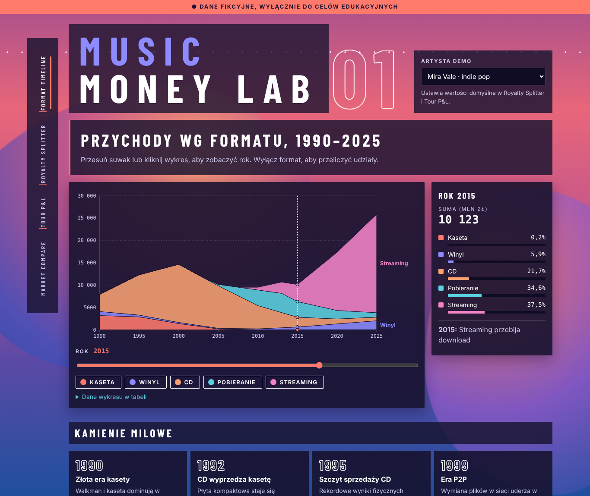
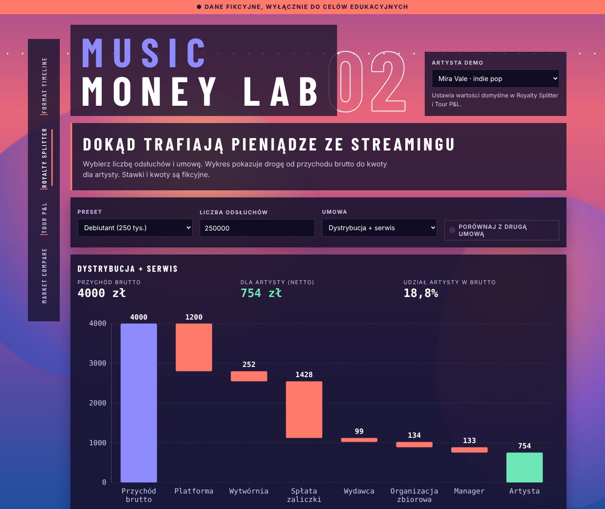
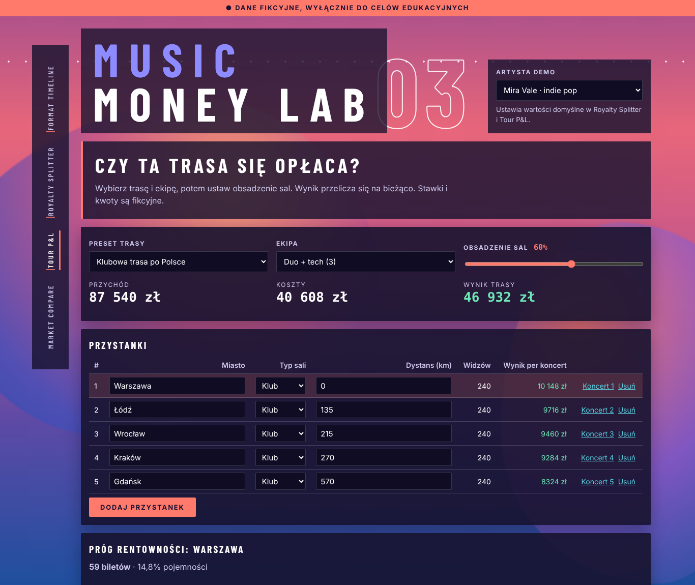
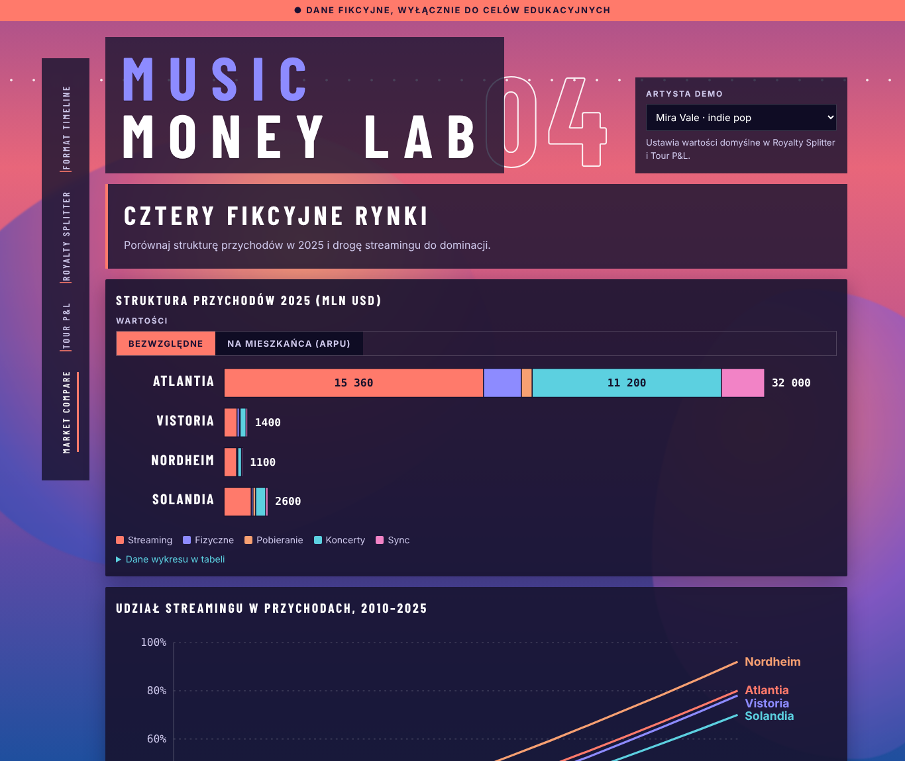

# Music Money Lab

Interactive web app that shows how money flows in the music industry. Built for ALK classes.
**All data is fictional and for education only.** Requirements: [docs/PRD.md](docs/PRD.md).

**Live:** https://mlodyfabi.github.io/alk-test/ (GitHub Pages)



| Royalty Splitter                         | Tour P&L                           | Market Compare                         |
| ---------------------------------------- | ---------------------------------- | -------------------------------------- |
|  |  |  |

Modules: Format Timeline, Royalty Splitter, Tour P&L, Market Compare. UI is in Polish.

## Run locally

```bash
npm install
npm run dev          # http://localhost:5173
```

| Command                 | Purpose                                              |
| ----------------------- | ---------------------------------------------------- |
| `npm test`              | unit tests (core logic, data validator)              |
| `npm run lint`          | ESLint, zero warnings                                |
| `npm run typecheck`     | TypeScript strict                                    |
| `npm run validate:data` | schema, percentage sums, cross references in `data/` |
| `npm run build`         | production build in `apps/web/dist`                  |

## Structure

```
apps/web/        React + Vite UI (modules in src/modules, SVG charts in src/components/charts)
packages/core/   pure logic: royalty, tour, market (no UI)
data/            fictional JSON + README
docs/            PRD, FORMULAS, DECISIONS
scripts/         validate-data
```

## Deploy

GitHub Pages works from the repo root (**Settings -> Pages -> Deploy from a branch -> `main` / `/ (root)`**): `index.html`, `assets/` and `.nojekyll` in the root are the built app. After every push to `main`, `.github/workflows/publish-root.yml` rebuilds and commits them. Locally: `npm run build:root`.

Alternative: `.github/workflows/deploy.yml` publishes via **Source: GitHub Actions** (use one mode, not both).

`.github/workflows/deploy.yml` publishes to GitHub Pages on every push to `main`.
One-time setup: repo **Settings -> Pages -> Source: GitHub Actions**.

See [CONTRIBUTING.md](CONTRIBUTING.md) for the branch and PR workflow.
